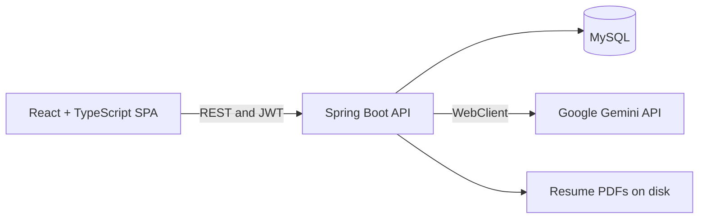

# InterviewForge

**An AI-powered mock interview platform.** Practice role-based technical and HR interviews, get every answer scored with written feedback, face adaptive follow-up questions, and track your progress against other students.

    

> Built as my 7th-semester B.Tech (CSE) project, with the aim of helping students prepare for campus placements.

**Demo video:** `<add link>`

---

## Highlights

- **Adaptive interviews.** The next question is generated from your previous answer. Difficulty rises after a strong answer and drops after a weak one, and the AI can ask follow-up questions.
- **Resume-aware questions.** Upload your PDF resume and the interviewer asks about your real projects and skills.
- **AI scoring with feedback.** Each answer is scored 0 to 100 with written feedback, followed by an overall summary with strengths and areas to improve.
- **Voice or text answers,** with a per-question timer that auto-submits when time runs out.
- **Progress tracking.** Score trend, topic-wise strengths, full interview history, and a weekly, monthly and all-time leaderboard.
- **Downloadable PDF report** for every interview.
- **Built to keep working.** If the AI service is slow or unavailable, the app falls back to a built-in question bank and estimated scores (clearly labelled), so an interview never breaks.

## Screenshots

| Dashboard | Interview setup |
|---|---|
|  |  |

| Live interview | Results |
|---|---|
|  |  |

| Progress | Leaderboard |
|---|---|
|  |  |

## Tech stack

| Layer | Technology |
|---|---|
| Frontend | React, TypeScript, Vite, Tailwind CSS, React Router, jsPDF |
| Backend | Java 21, Spring Boot 4, Spring Security (JWT), Spring Data JPA / Hibernate, Bean Validation |
| Database | MySQL 8 |
| AI | Google Gemini API (called with Spring WebClient; JSON-mode responses) |
| Other | Apache PDFBox (resume text extraction), Web Speech API (voice input) |

## Architecture



The backend follows a layered design: **Controller → Service → Repository**, with DTOs and mappers between the API and the entities.

**How an interview works**

1. The student picks a role, type (Technical or HR), difficulty, topics, and optionally a company template or a resume.
2. The backend creates a session and asks Gemini for a first question, using the topics, the resume text, and the questions already asked.
3. Each submitted answer is scored by Gemini. The score and the answer then shape the next question: difficulty changes, and it may become a follow-up.
4. After the last question, an AI-written summary, strengths and improvements are generated, and the report can be downloaded as a PDF.

## Engineering decisions

- **Stateless JWT authentication** with Spring Security. Expired or forged tokens return a clean `401`.
- **Ownership checks on every resource.** Sessions, answers, reports and resumes are looked up through the logged-in user, never through an ID sent by the client. "Not found" and "not yours" return the same `404`, so IDs can't be probed.
- **Graceful AI degradation.** Every Gemini call has a fallback: a second model is tried first, then a local question bank, a length-based score estimate, and a rule-based summary.
- **Prompt-injection awareness.** Candidate answers and resume text are passed to the model as *data to be graded*, not instructions.
- **Validated input and uploads.** Bean Validation on all request bodies, and resumes are checked by type, size and PDF signature before they are stored.
- **Secrets stay out of the code.** The database password, JWT secret and Gemini key are read from environment variables.

## Run locally

**Prerequisites:** JDK 21+, Node.js 20+, MySQL 8, and a free [Gemini API key](https://aistudio.google.com/app/apikey).

### 1. Backend

```powershell
cd backend

# set these in the same terminal (use your own values)
$env:DB_PASSWORD   = "your-mysql-root-password"
$env:JWT_SECRET    = "a-long-random-text-of-at-least-32-characters"
$env:GEMINI_API_KEY = "your-gemini-key"

.\mvnw.cmd spring-boot:run
```

On Linux or macOS, use `export NAME=value` and `./mvnw spring-boot:run`.

The API starts on `http://localhost:8080`. The database `interviewforge_db` and all tables are created automatically, and the starter topics and company templates (TCS, Infosys, Accenture) are seeded on the first run.

### 2. Frontend

```bash
cd frontend
npm install
npm run dev
```

Open `http://localhost:5173`. Sign up for an account, and you are ready to start an interview.

> Voice answers use the browser's speech recognition, which works in **Chrome and Edge** and needs an internet connection.

## API overview

| Area | Endpoints |
|---|---|
| Auth | `POST /api/auth/signup`, `POST /api/auth/login` |
| Account | `GET` and `PUT /api/users/me`, `PUT /api/users/me/password` |
| Interviews | `POST /api/sessions`, `GET /api/interviews/{id}`, `POST /api/interviews/{id}/answers`, `GET /api/interviews/{id}/result`, `PATCH /api/sessions/{id}/end` |
| Setup data | `GET /api/topics/predefined`, `GET /api/templates` |
| Resumes | `POST`, `GET` and `DELETE /api/resumes` |
| Insights | `GET /api/dashboard`, `GET /api/progress`, `GET /api/leaderboard?period=week\|month\|all` |

All endpoints except `/api/auth/**` require `Authorization: Bearer <token>`.

## Project structure

```
backend/src/main/java/com/interviewforge/backend/
  controller/   REST endpoints
  service/      business logic (interview flow, Gemini, dashboard, leaderboard)
  repository/   Spring Data JPA repositories
  entity/       JPA entities
  dtos/         request and response objects
  security/     JWT filter, current-user and ownership helpers
  config/       security, CORS, Gemini client, data seeding
frontend/src/
  pages/        one component per screen
  components/   reusable UI pieces
  services/     API calls
  context/      auth and theme state
  lib/          API client with JWT handling
```

## Roadmap

- Password reset by email
- Automated tests (JUnit for services, Vitest for the UI)
- Docker setup and cloud deployment
- Richer resume analysis (skills extraction)
- Rate limiting on AI-backed endpoints

## Author

**Harshita Shekhawat**, B.Tech Computer Science, Government Women Engineering College, Ajmer.
[GitHub](https://github.com/Harshiita-02) · [LinkedIn](https://www.linkedin.com/in/harshita-shekhawat-2dec4/) · `h.shekhawat0248@gmail.com`
